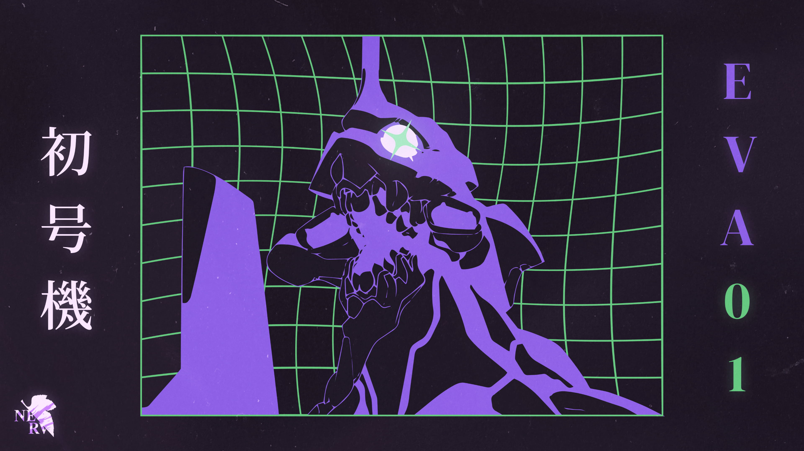

# EVA01 COSMIC desktop

An EVA-01 themed COSMIC setup with violet backgrounds, lavender text and lime
accents. Includes the desktop layout, terminal, application themes, cursors,
icons, wallpapers and an installer with automatic file backups.



## Install

For an existing COSMIC desktop with **Python 3.12+**. Fedora is the supported
package-installation target. The script does not install COSMIC or an OS.

```sh
git clone https://github.com/Mfvesaw/eva01-cosmic-dotfiles.git
cd eva01-cosmic-dotfiles
./install.sh --dry-run
./install.sh
```

Read the **[installation guide](docs/INSTALL.md)** for prerequisites, package
installation, app setup, backups, rollback and troubleshooting. Close themed
apps before restoring their preferences. Log out and back in after installation
to refresh the cursor and Qt environment, then open a new Fish terminal.

| Option | Behavior |
| --- | --- |
| `--dry-run` | Verify files and show planned changes without modifying the system. |
| `--dependencies` | Install the Fedora terminal, font, Qt and KiCad packages with sudo. |
| `--apps` | Install every Flatpak app in the saved inventory, including applets. |
| `--wallpaper purple-nebula` | Select the nebula wallpaper instead of EVA-01. |
| `--home /tmp/eva01-test-home` | Restore files into an isolated folder, skipping desktop integration. |

## What's included

| Component | Theme/configuration |
| --- | --- |
| COSMIC | Desktop palette, panel/dock layout and thin lime borders, workspaces, shortcuts, window rules and applets. |
| Terminal | Static colored EVA head in Fastfetch, rounded Starship prompt, Fish completions and a steady I-beam. `clear` and Ctrl+L redraw the card; Ctrl+L preserves typed input. |
| GTK / Qt | GTK 3/4, Qt 5/6 and KDE colors; matching Flatpak appearance settings. |
| Icons / cursor | Purple Colloid variants and EVA01 cursor theme. |
| Browser / editors | Zen browser chrome, VS Code, IntelliJ and Obsidian themes. Websites keep their own styling. |
| CAD / chat | KiCad, FreeCAD and Vesktop themes. |
| Older applets | A legacy COSMIC theme copy kept in sync for clients such as Pomodoro. |

The palette centers on `#211928`, `#25154A`, `#995CD0`, `#8EDF5F` and `#ECDCFF`.
This restores a saved desktop layout; monitor names and scaling may need adjusting
on different hardware. App-specific details are in [apps/](apps/).

## Recreate the Zen / MYNT screenshot

Follow the **[Zen + MYNT replication guide](docs/ZEN-MYNT.md)** for the extension
link, light widget mode, purple accent, wallpaper upload, clock/weather/search
settings and right-side COSMIC panel. It includes the supplied reference image.
MYNT is configured manually; no browser profile or personal extension export
is imported by the installer. Steam theming is no longer included.

## Wallpapers

Both supplied originals are included without resizing or recompression:

- [EVA-01 — 2560 × 1440](wallpapers/eva01.jpg)
- [Purple nebula — 3000 × 2000](wallpapers/purple-nebula.jpg)


```sh
./install.sh --wallpaper purple-nebula
```

Both are installed to `~/.local/share/backgrounds/EVA01/`. Select either one in
COSMIC Settings → Desktop → Wallpaper. [Wallpaper details and attribution](wallpapers/README.md).

## Terminal artwork

```sh
eva01-art                 # static colored ASCII
eva01-art --width 64      # larger version
eva01-art --plain         # plain ASCII
fastfetch                 # artwork with system information
```

[ASCII preview](assets/eva-head-ascii-preview.png). Rebuilding the artwork with
`scripts/build-ascii.py` requires Pillow; displaying it only needs Python.

## Backups and maintenance

The installer preserves replaced files under `~/.local/state/eva01/backups/`.
[Rollback instructions](docs/INSTALL.md#backups-and-rollback) explain what the
file restore covers.

To update your own configuration snapshot:

```sh
./backup.sh
git diff --stat
# Review the changes before committing or pushing.
```

This repository is public. The snapshot uses an allowlist and excludes account
databases, browser sessions/history, notes, game saves, caches and shell history.
Review new app settings before publishing them. Run
`EVA01_REFRESH_ASSETS=1 ./backup.sh` after changing theme/icon/cursor assets.
The included checker scans common credential formats and verifies archive paths.

If COSMIC regenerates the panel border colors:

```sh
python3 scripts/match-panel-borders.py
```

[Validation notes](metadata/VALIDATION.md) describe the isolated restore,
rollback, native theme-parser and app-style checks that were run. Clean-OS
package installation has not been tested.

## Credits

Theme/icon assets retain their upstream license files in the asset archive.
Supplied Evangelion artwork and wallpapers remain the work of their respective artists/rightsholders;
this repository does not claim authorship or relicense those images.
