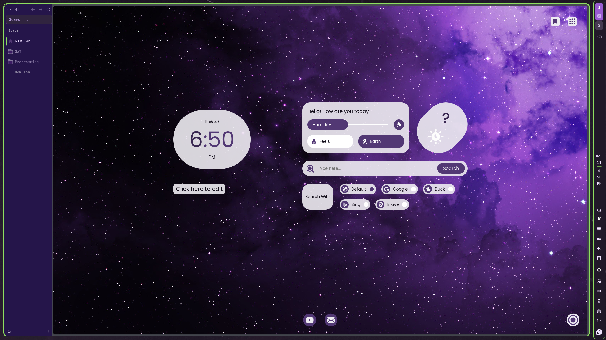

# Recreate the Zen + MYNT setup



This combines three separate parts: the EVA01 COSMIC/Zen colors, MYNT's
Material You new-tab widgets, and the bundled purple nebula wallpaper. The
browser uses a dark purple interface while the new-tab widgets use **Light**
mode. Ordinary websites keep their own appearance.

The settings below use MYNT **3.3.802**, matching the installed extension used
for this setup. Later versions may move or rename controls. This is a manual
replication guide; the installer does not import a browser profile or install
MYNT automatically.

## 1. Install the desktop and Zen appearance

Follow the [installation guide](INSTALL.md), selecting the nebula wallpaper:

```sh
git clone https://github.com/Mfvesaw/eva01-cosmic-dotfiles.git
cd eva01-cosmic-dotfiles
./install.sh --dry-run --wallpaper purple-nebula
./install.sh --wallpaper purple-nebula
```

For a fresh Zen install, launch Zen once to create its profile, fully close it,
then run the installer again. It discovers existing Flatpak Zen profiles and
applies the EVA01 `userChrome.css`, `userContent.css` and `user.js` blocks.
Reopen Zen afterward.

The browser chrome is deep purple with lavender text and violet controls. MYNT
is responsible for the clock, search, weather and other new-tab widgets; these
do not come from `userChrome.css`.

## 2. Install MYNT in Zen

Open the official Firefox add-on page **inside Zen** and install:

[MYNT: Material You New Tab](https://addons.mozilla.org/en-US/firefox/addon/mynt/)

Accept its new-tab replacement prompt, then open a new tab. Open MYNT's settings
with the round button in the lower-right corner of the new-tab page. Another
extension that replaces new tabs must be disabled for MYNT to appear.

## 3. Appearance and wallpaper

In MYNT settings, find **Appearance**:

| Setting | Value for this look |
| --- | --- |
| Appearance mode | **Light**, even though Zen and COSMIC are dark. |
| Pick color | Select the purple preset, or pick a violet such as `#995CD0`. MYNT generates its own light tints from this accent. |
| Upload Wallpaper | Choose this repository's [purple-nebula.jpg](../wallpapers/purple-nebula.jpg). |
| Opacity | Start at **90%**; adjust to get the pale translucent widget surfaces in the reference. |

After installation the wallpaper is also available at:

```text
~/.local/share/backgrounds/EVA01/purple-nebula.jpg
```

Upload it through **MYNT's** wallpaper control as well as selecting it for the
desktop. A desktop wallpaper setting does not automatically set an extension's
background. Retain the default image crop/cover behavior so the nebula fills
the new-tab content area.

The screenshot is a visual reference, not a measurement of the original color
picker or opacity. The purple preset or the suggested accent gives the intended
violet/pale-lavender combination; adjust to your display if needed.

## 4. Clock, weather and search

Use these MYNT controls:

| Section / setting | Selection |
| --- | --- |
| Clock → Hide Clock | Off. |
| Clock → Digital Clock | On: the rounded digital clock on the left. |
| Clock → 12-Hour Format | On for the AM/PM display shown. |
| Clock → Customizable Text | On. Click below the clock to edit it; leaving it untouched shows “Click here to edit.” |
| Clock → Greeting | Off to keep the space below the clock clear, as in the reference. |
| Weather → Hide Weather | Off. |
| Weather → Hide Weather Card | Off to retain the full card beside the clock. |
| Search → Hide Microphone Icon | On for the simple search field shown. |
| Search → Hide Search Engines | Off. Keep the default “Search With” mode so the engine choices appear below. |
| Search → Motivational Quotes | Off for this uncluttered layout. |

The reference weather card shows **Earth** and **?**, its unconfigured state.
For working weather, enter your own location in **Weather → Enter your Location**
and save it. GPS and a WeatherAPI key are optional settings; a key is only needed
if the extension's normal weather service does not work. Use your own values.

## 5. Corner buttons and shortcuts

In MYNT's **Personalization** section:

- Enable **Bookmarks** and **Google Apps** for the two buttons at the upper right.
- Disable **AI Tools** and **To Do List** for the same sparse layout.

In **Shortcuts**, enable **Show saved shortcuts**, open **Edit Shortcuts**, and
keep YouTube and Gmail for the two bottom buttons shown. Enable **Adaptive Icons**
so the icons follow the purple theme. Other shortcuts are optional.

Start with the new-tab page at 100% zoom. Use Ctrl+Plus / Ctrl+Minus if the widget
group needs resizing for your resolution. The screenshot is 2560 × 1440; exact
spacing will vary with display scaling, browser sidebar width and page zoom.

## 6. COSMIC panel and Zen sidebar

For the right-edge panel in the reference, use COSMIC Settings → Desktop → Panel
to place the panel on the **right** and use a small size. The saved setup uses
an XS panel, 6 px padding, 4 px spacing and a 4 px margin. The panel and window
highlight use lime `#8EDF5F`; the panel border is 1 px.

If a COSMIC theme rebuild changes the panel/dock border color, reapply it:

```sh
python3 scripts/match-panel-borders.py
```

Keep Zen's sidebar on the left. Spaces, pinned tabs and folders such as SAT or
Programming are personal organization: create and name your own if desired.
The installer does not publish or import browsing tabs, bookmarks or accounts.

## Save your finished MYNT setup

MYNT settings provide **Backup** and **Restore** controls. After arranging the
page, use **Backup** to save a `MYNT_Backup_<date>.json` file. On another device,
install MYNT and use **Restore** to import that file.

The extension's backup contains its local settings and uploaded background;
review it before sharing because it may also contain custom text, shortcuts,
weather location and other personal widget data. No personal MYNT export is
included in this repository.

Upstream links: [Firefox add-on](https://addons.mozilla.org/en-US/firefox/addon/mynt/)
and [MYNT source](https://github.com/prem-k-r/MaterialYouNewTab).
