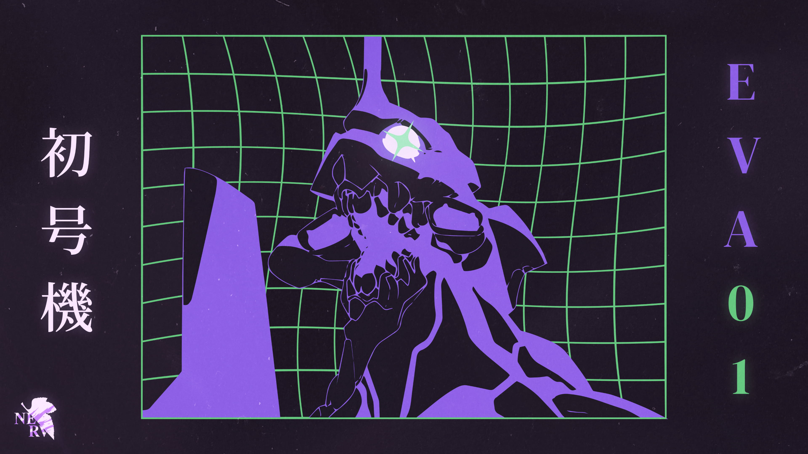
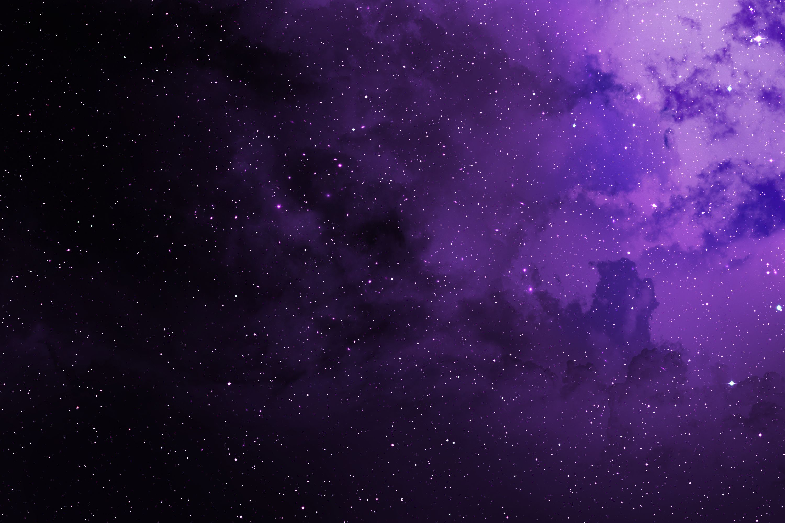

# Wallpapers

Both original JPEGs are included without resizing or recompression.

| File | Resolution | Original supplied filename |
| --- | --- | --- |
| [eva01.jpg](eva01.jpg) | 2560 × 1440 | wallpaperflare.com_wallpaper(1).jpg |
| [purple-nebula.jpg](purple-nebula.jpg) | 3000 × 2000 | rlh1m0sm33gf1.jpg |

The installer copies both to `~/.local/share/backgrounds/EVA01/`. EVA-01 is
selected by default; use `./install.sh --wallpaper purple-nebula` for the nebula.
They can also be selected manually in COSMIC Settings → Desktop → Wallpaper.

These images were supplied by the desktop owner. Original artists and rights
holders retain their rights; inclusion does not place the artwork under an
open-source software license. Artist attribution was not supplied with the files.
